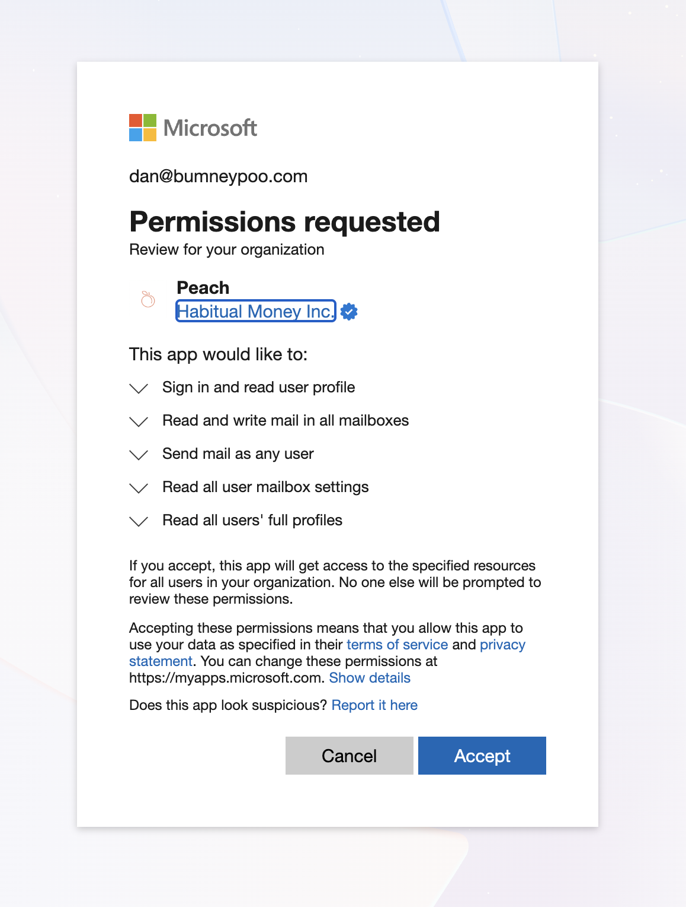
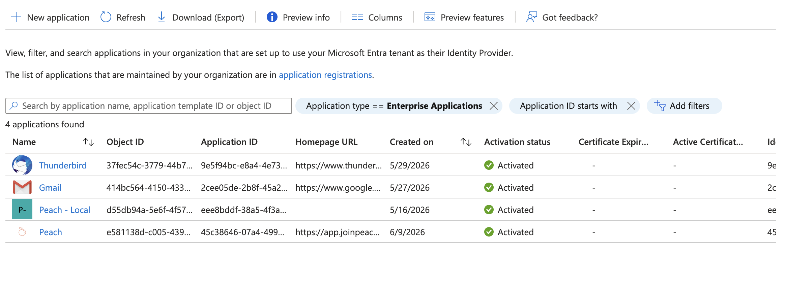
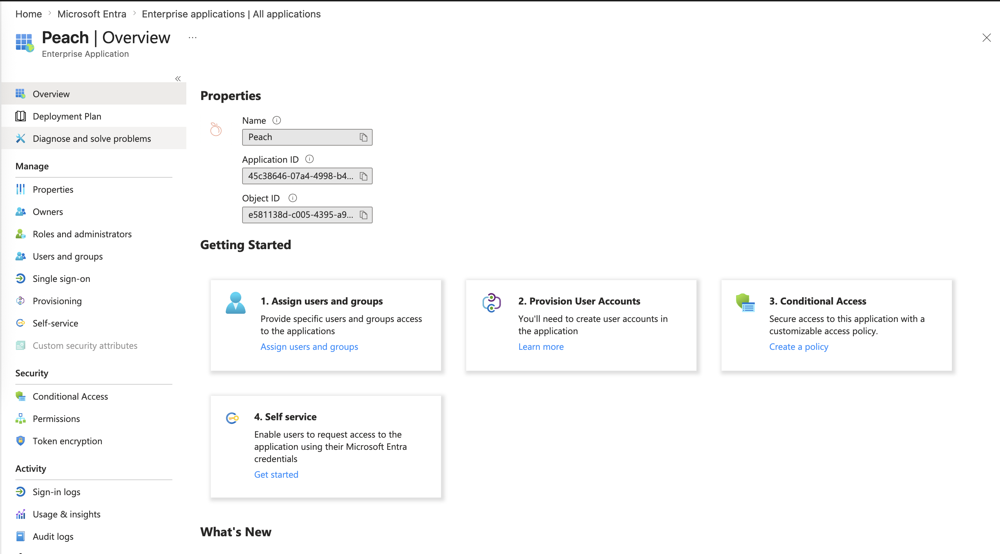
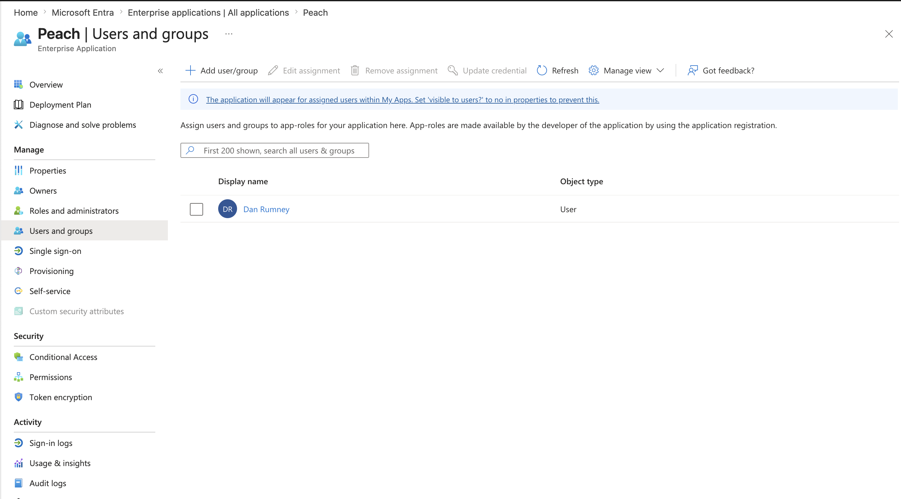
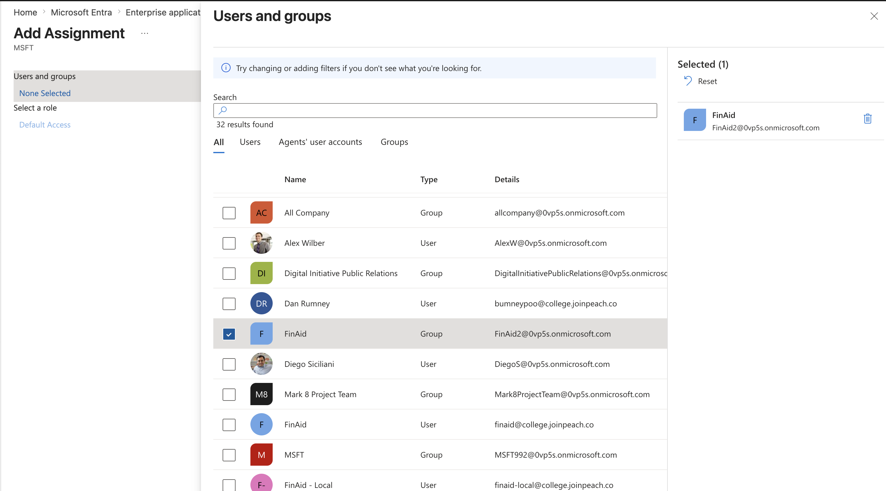
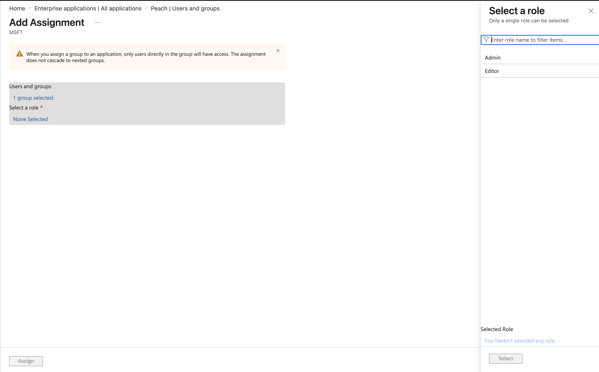

Connect Peach to Microsoft 365 so your team can authenticate with Microsoft, access shared mailboxes, and send emails directly from Peach.

## What you'll accomplish

After completing this guide:

- Peach will appear as an Enterprise Application in Microsoft Entra
- Users will be able to sign in using Microsoft 365
- Shared mailboxes can be connected to Peach
- Your team can send and receive emails from Peach

<Info>
  You must be a Microsoft Entra administrator to complete this setup.
</Info>

## Prerequisites

Before you begin, ensure you have:

- Microsoft Entra admin access
- At least one shared mailbox
- Permission to add Enterprise Applications

---

## Step 1: Grant Admin Consent

Open the following URL while signed in as a Microsoft administrator:

```text
https://login.microsoftonline.com/organizations/adminconsent?client_id=45c38646-07a4-4998-b43c-58e1b5c0bcee
```

Microsoft will display the permissions requested by Peach.

Select **Accept**.

<Note>
  This creates the Peach Enterprise Application within your Microsoft tenant.
</Note>



---

## Step 2: Verify Peach was added

Navigate to:

```text
Microsoft Entra → Enterprise Applications
```

Refresh the page.

You should see **Peach** listed among your applications.



<Check>
  If Peach appears in Enterprise Applications, the consent step was successful.
</Check>

---

## Step 3: Open the Peach application

Select **Peach** from the Enterprise Applications list.



---

## Step 4: Assign users and groups

Navigate to:

```text
Users and Groups
```

Select **Add User/Group**.

Choose the users or groups that should have access to Peach.



<Frame>
  
</Frame>

---

## Step 5: Assign roles

Each user or group must be assigned a role.

<CardGroup cols={2}>
  <Card title="Admin">
    Manage users, integrations, shared inboxes, and platform settings.
  </Card>

  <Card title="Editor">
    Work tickets, generate AI responses, and send emails from connected inboxes.
  </Card>
</CardGroup>

Select the appropriate role before saving the assignment.



<Warning>
  Users who are not assigned to the Peach application will not be able to sign in.
</Warning>

---

## Verify access

Ask an assigned user to:

1. Navigate to `app.joinpeach.co`
2. Select **Sign in with Microsoft 365**
3. Complete authentication

If login succeeds, the Microsoft integration is configured correctly.

<Check>
  Successful login confirms that Peach has been properly configured within your Microsoft tenant.
</Check>

---

## Troubleshooting

<AccordionGroup>
  <Accordion title="Peach does not appear in Enterprise Applications">
    Verify the admin consent step was completed using a Microsoft Entra administrator account.
  </Accordion>

  <Accordion title="Users cannot sign in">
    Confirm the user or security group has been assigned to the Peach Enterprise Application.
  </Accordion>

  <Accordion title="Shared mailbox does not appear during onboarding">
    Verify the user has access to the shared mailbox in Microsoft 365.
  </Accordion>
</AccordionGroup>

---

## Next Steps

<CardGroup cols={2}>
  <Card title="Permissions" icon="shield" href="https://docs.joinpeach.co/permissions">
    Review the permissions Peach requires and why.
  </Card>

  <Card title="Test Email Delivery" icon="send" href="https://docs.joinpeach.co/troubleshooting#test-outbound-email-delivery">
    Verify Peach can successfully send outbound emails.
  </Card>
</CardGroup>
