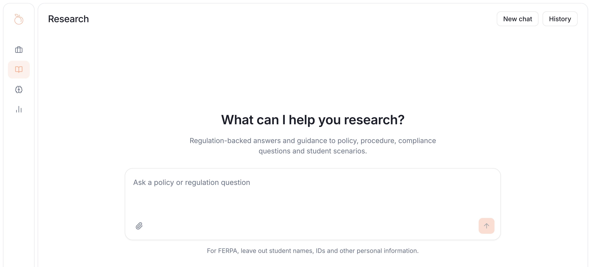

The AI research assistant gives financial aid staff a place to ask questions about financial aid regulations, institutional policies and procedures, and complex student scenarios.

Enter a question or describe a scenario in plain language, and Peach will provide guidance using the same knowledge sources available to its AI-generated email drafts.

---

## Ask a question

Enter your question or scenario into the prompt box.

The information you provide in your prompt gives Peach the context it needs to generate a response.

You can ask straightforward questions or describe more complex situations that would normally require researching multiple sources.

For example:

- How do I determine if a student is dependent or independent?
- What are the requirements for satisfactory academic progress?
- When can a school exercise professional judgment?
- What happens when a student withdraws during a payment period?
- How should conflicting information be resolved?

<Frame>
  
  
</Frame>

<Tip>
  Include relevant details in your question, such as the award year or program involved, to give Peach the context it needs to provide useful guidance.
</Tip>

---

## What Peach can reference

The AI Research Assistant has access to the same knowledge sources Peach can reference when generating AI-assisted email drafts.

This includes federal financial aid sources as well as the policies, procedures, and other resources your institution has added to its knowledge base.

Federal sources include:

- Federal Student Aid Handbook, by award year
- Federal statutes and regulations, including the Higher Education Act and CFR Title 34
- U.S. Department of Education and Federal Student Aid guidance
- Dear Colleague Letters
- Electronic Announcements
- Published FSA guidance and interpretations
- Student-facing federal guidance
- Regulatory and legislative developments

Peach can also reference institution-specific resources that your team has added to the knowledge base.

<Info>
  Adding your institution's policies and procedures to the knowledge base gives both the AI assistant and AI-generated email drafts access to your school's specific guidance.
</Info>

[Learn more about the knowledge base →](/knowledge-base)

---

## Ask about complex student scenarios

The AI research assistant can help staff work through questions involving a specific set of circumstances.

Describe the scenario in the prompt and include the details that are relevant to the financial aid question.

Peach can use the context you provide to identify relevant information from its knowledge sources and generate guidance for the scenario.

<Warning>
  Do not enter student names, IDs, Social Security numbers, or other personally identifiable information (PII) into the AI assistant. Describe student scenarios without information that identifies the student.
</Warning>

---

## AI research assistant vs. AI-generated drafts

The AI research assistant and AI-generated drafts use the same underlying knowledge sources. The difference is the context Peach uses and the type of response it generates.

### AI research assistant

When using the AI Research Assistant, **your prompt provides the context**.

Ask a question or describe a scenario, and Peach uses that context to provide guidance based on relevant federal and institutional knowledge.

### AI-generated drafts

When using **Draft with AI** inside a case, **the student inquiry and case history provide the context**.

Peach uses that context and the same underlying knowledge sources to generate an email response for staff to review and send.

<Info>
  Think of the AI assistant as a research and guidance tool for staff, while AI-generated drafts apply that same knowledge to help respond to a student.
</Info>

[Learn more about AI-generated drafts →](https://docs.joinpeach.co/ticket-details#draft-with-ai)
