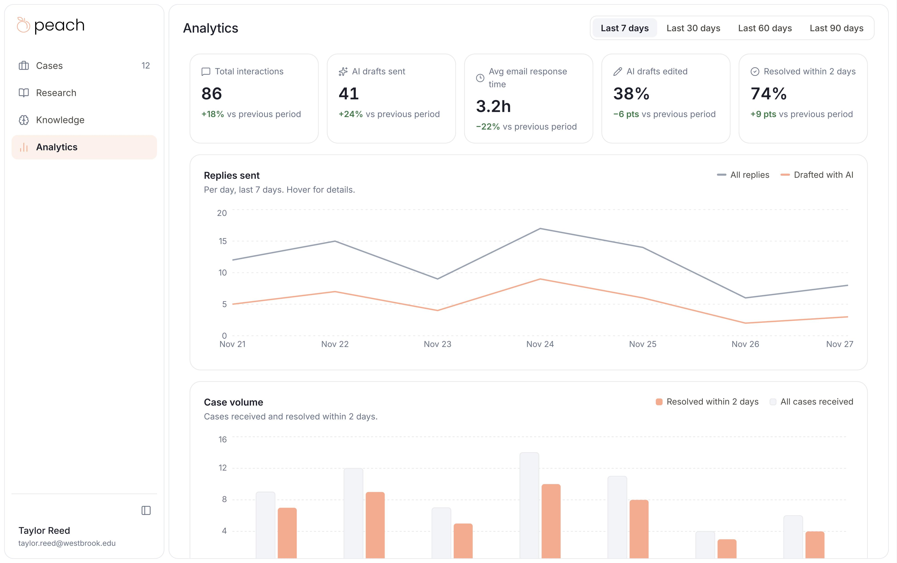

Analytics shows how your office is handling student communications: how many interactions you receive, how your team uses AI drafts, how quickly cases are resolved, and who is working on what.

---

## **Choose a time period**

Use the buttons in the upper-right corner to view the **Last 7 days**, **Last 30 days**, **Last 60 days**, or **Last 90 days**.

Each summary metric is compared to the previous period of the same length. For example, the last 7 days are compared to the 7 days before that.

---

## **Summary metrics**

| **Metric** | **What it shows** |
| --- | --- |
| **Total interactions** | Emails, calls, and other interactions with students in the period |
| **AI drafts sent** | Replies sent that started from Draft with AI |
| **Avg email response time** | The average time it took your team to respond to student emails |
| **AI drafts edited** | The percentage of AI drafts staff changed before sending |
| **Resolved within 2 days** | The percentage of cases resolved within two days of being received |

---

## **Charts**

### **Replies sent**

Replies sent per day, with **All replies** compared to replies **Drafted with AI**. Hover over a day for details.

### **Case volume**

Cases received per day, with the number **Resolved within 2 days** shown against **All cases received**.

### **Categories**

The number of cases in each category for the period. Use this to see which topics students are asking about most.

### **Interaction types**

How students reached your office, such as email, phone call, appointment, or walk-in.

### **Case status distribution**

How all of your cases are spread across **Not started**, **In progress**, **On hold**, **Resolved**, and **No case required** right now. This chart is not affected by the time period.

<Frame>
  
  
</Frame>

---

## **Team activity**

### **Team member activity**

For each team member in the period:

- **Replies sent**
- **Cases resolved**
- **Calls logged**

### **Team member outstanding cases**

Open cases by owner right now, broken down by **Not started**, **In progress**, and **On hold**. Cases with no owner are listed as **Unassigned**.

<Tip>
  Use **Team member outstanding cases** to rebalance work, and a growing **Unassigned** count as a sign that categories may need team members assigned to them.

  [Learn more about Categories →](/settings/categories)
</Tip>
