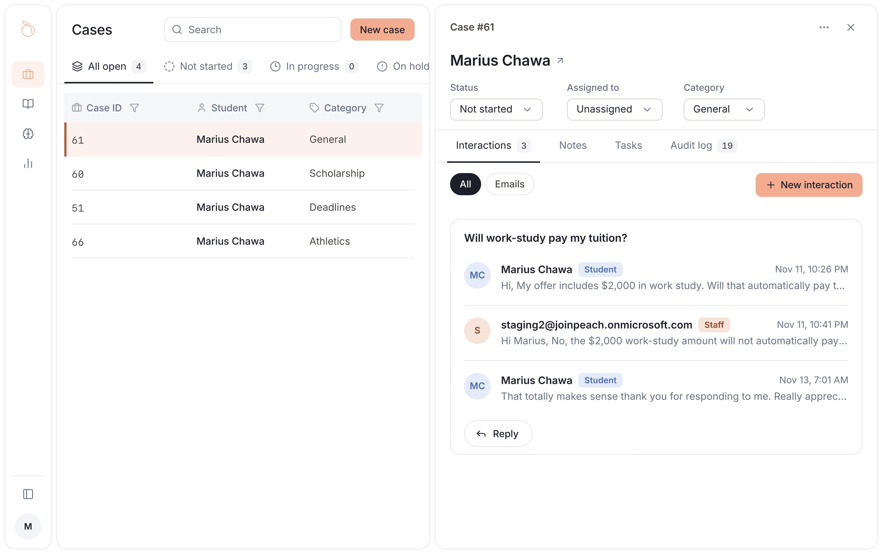
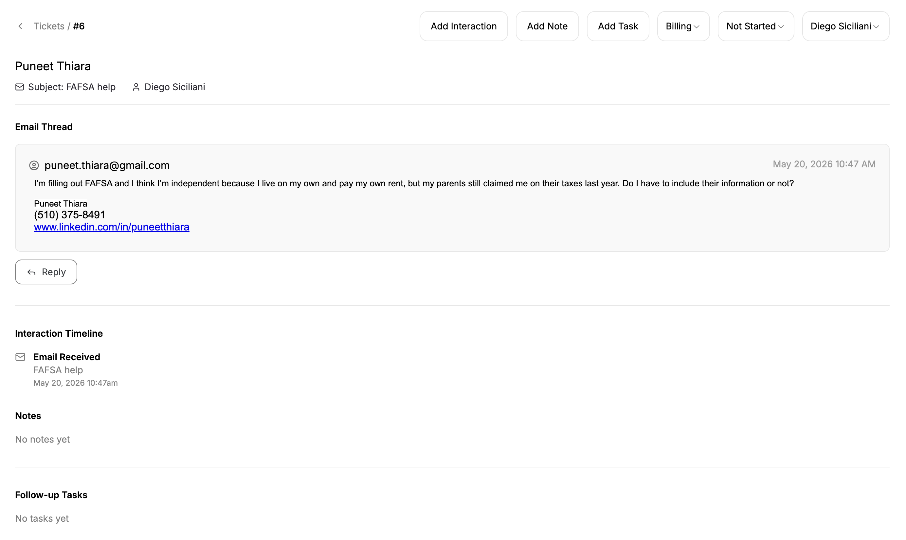
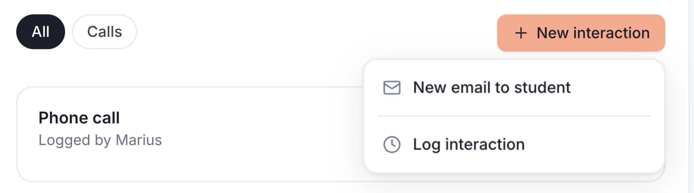
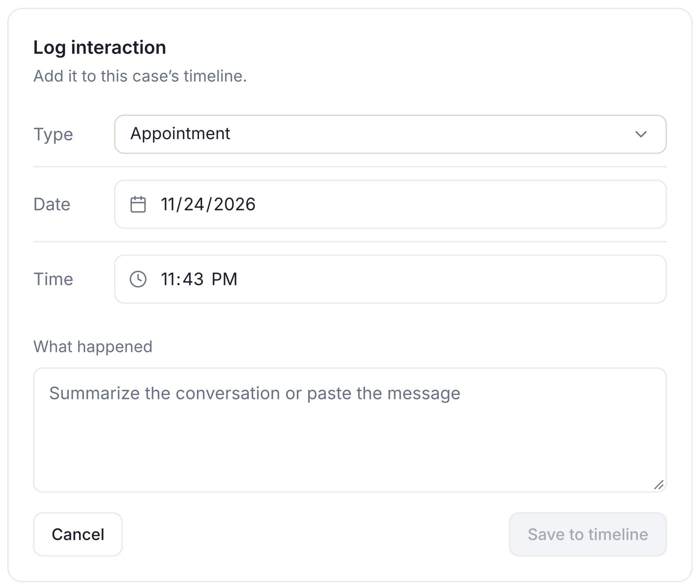
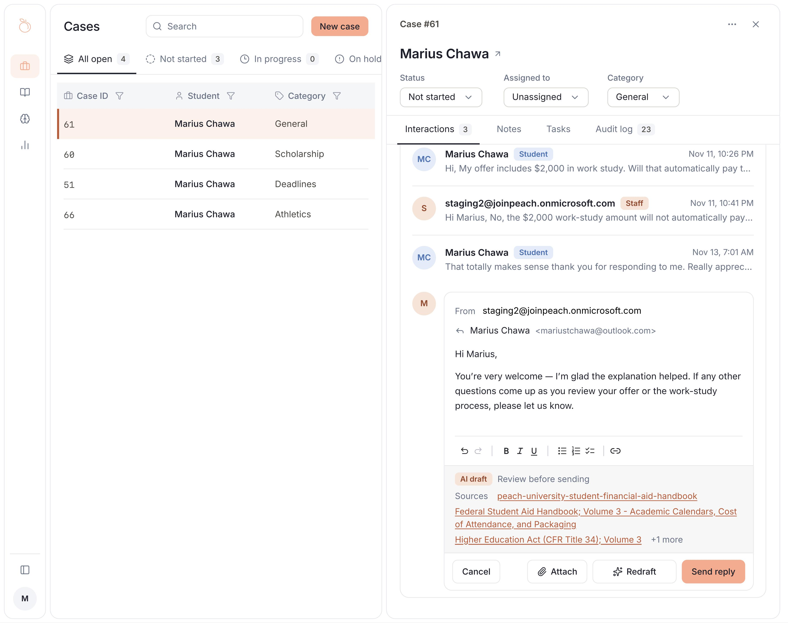

Open a case to view the full history of a student inquiry, respond to the student, collaborate with your team, and manage follow-up activity.

Each case brings together the conversation, interactions, internal notes, tasks, an audti log, assignment, and status in one place.

---

## Case overview

Cases open in a panel beside the case list. At the top of the panel you can see the case number, the student's name, and three controls: **Status, Assigned to, Category**

Below these, the case is organized into four tabs: **Interactions**, **Notes**, **Tasks**, and **Audit log**.

<Frame>
  
  
</Frame>

---

## Manage a case

### Update the status

Use the status dropdown to reflect the current state of the case.

Available statuses include:

- **Not Started**
- **In Progress**
- **On Hold**
- **Resolved**
- **No Ticket Required**

### Assign the case

Use the **Assigned to** dropdown to assign the case to a team member.

Assignment makes it clear who is responsible for following up.

<Tip>
  Cases can also be automatically assigned to specific team members based on their category. This can help route incoming inquiries to the right person without requiring manual assignment.
</Tip>

### Change the category

Use the category dropdown to update the topic associated with the case.

Categories help your team organize inquiries and can also be used to filter cases from the Cases page.

<Note>
  Categories can be customized to match the types of inquiries your office receives.

  [Learn more about Category management →](/settings/category-management)
</Note>

### View the student

Select the student's name at the top of the case to open their profile.

The student profile shows the student's email address and phone number, and lists their cases with each case's category, assignee, and status. Select **Add phone** to record a phone number if it's not listed already.

Select **Back** to return to the case.

### Interactions

The **Interactions** tab shows every email, call, and other interaction on the case, newest activity in context.

Email conversations are grouped by subject, with each message labeled **Student** or **Staff**. Logged interactions, such as phone calls, show who logged them and when.

Use the filters at the top of the tab, such as **All**, **Emails**, or **Calls**, to show only one type of interaction.

<Info>
  Adding interactions keeps relevant student communications together so staff can see the full context of an inquiry in one case.
</Info>

### **Log an interaction**

Use **Log interaction** to record a conversation that happened outside email.

<Frame>
  
</Frame>

- Select **New interaction** → **Log interaction**.
- Choose the **Type**: **Appointment**, **Email**, **Phone call**, **Text**, **Video call**, or **Walk-in**.
- Set the **Date** and **Time** it happened.
- Under **What happened**, summarize the conversation or paste the message.
- Select **Save to timeline**.

<Frame>
  
  
</Frame>

### **Email a student**

To send a new email to the student from the case, select **New interaction** → **New email to student**.

---

## Reply to a student

You can respond to an email directly from the case.

There are two ways to draft a response.

### Write your own response

Type directly into the response editor.

You can format your response and attach files before sending.

### Draft with AI

Select **Draft with AI** to have Peach generate a response based on the context available in the case.

Peach can use information including:

- The student's inquiry
- Earlier messages in the case
- Institutional policies and procedures available to Peach
- Other relevant case context

<Frame>
  
  
</Frame>

<Info>
  AI-generated drafts are designed for staff review. You can edit the response before sending it to the student.
</Info>

### Regenerate a draft

If you want Peach to create a different response, select **Redraft**.

The existing draft will be replaced with a newly generated response based on the case context.

### Attach files

Select **Attach** to include documents or other files with your response.

When your response is ready, select **Send reply**.

---

### Notes

The **Notes** tab displays internal notes that have been added to the case.

Notes help staff share context that should remain internal to the financial aid office.

<Info>
  Notes are not included in emails sent to students.
</Info>

### Tasks

The **Tasks** tab displays tasks associated with the case.

Use tasks to keep track of additional work that needs to be completed as part of resolving the student's inquiry.

### Audit log

The **Audit log** tab is a complete history of changes to the case, such as when it was created, assigned, recategorized, or changed status, along with who made each change and when.

Filter the log to **All**, **Staff**, or **Student** activity.

---

## Keep the full history together

A case can contain more than an email conversation.

By adding interactions, notes, and tasks, your team can maintain a complete record of work related to the student's inquiry.

For example:

<Steps>
  <Step title="Student sends an email">
    The original inquiry is automatically imported from the shared inbox.
  </Step>
  <Step title="Staff calls the student">
    The phone conversation is added using **New Interaction**.
  </Step>
  <Step title="A follow-up is needed">
    A staff member creates a task to track the additional work.
  </Step>
  <Step title="Internal context is recorded">
    A note is added so other team members have the context they need.
  </Step>
  <Step title="The student receives a response">
    Staff draft and send the final email directly from the case.
  </Step>
</Steps>

This keeps the full history of the inquiry available to anyone on your team who needs to work on it.
