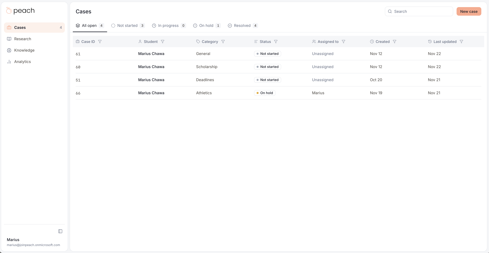
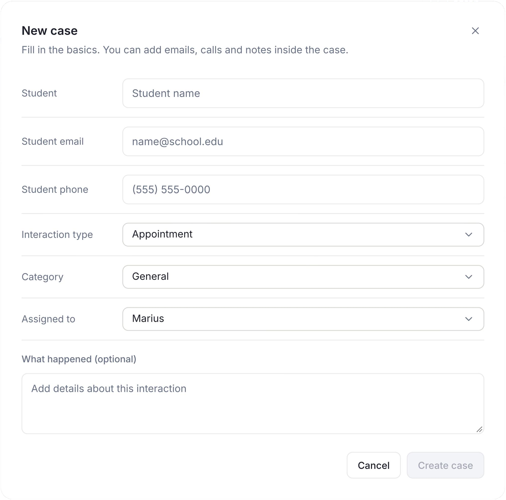
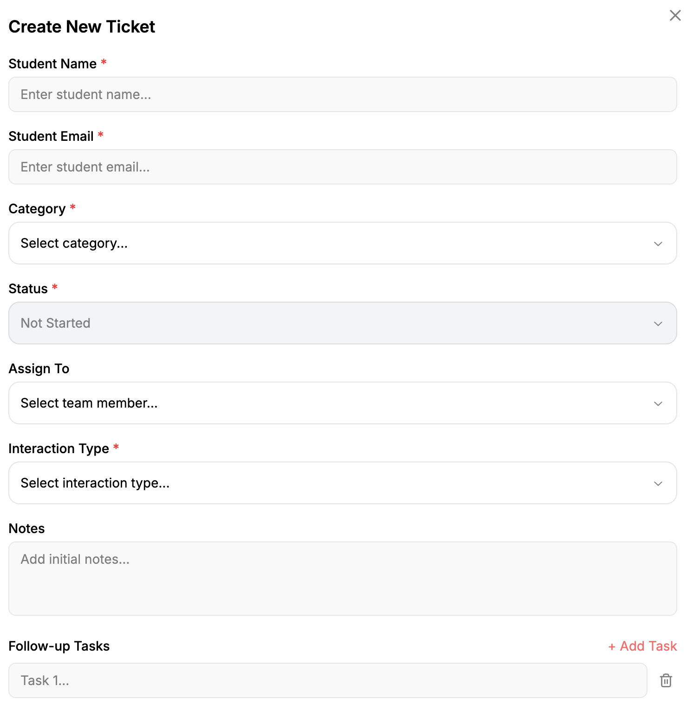

The Cases page gives your team a central view of student inquiries and other communications.

Emails received by your connected shared inbox are automatically brought into Peach and organized as cases, allowing your team to track and manage inquiries in one place.

---

## View cases

The Cases page displays all cases across your connected shared inboxes.

At a glance, you can see:

- **Case ID**: The unique ID assigned to the case
- **Student**: The student or sender associated with the inquiry
- **Category**: The financial aid topic associated with the case
- **Status**: The case's current status
- **Assigned To**: The team member responsible for the case
- **Created Date**: When the case was created
- **Last Updated**: When activity most recently occurred on the case

<Frame>
  
  
</Frame>

<Info>
  Emails received through your connected shared inbox automatically appear in Peach as tickets. Your team does not need to manually create a ticket for each incoming email.
</Info>

---

## Case status

The tabs at the top of the page show your current workload and let you switch between groups of cases. Each tab shows a count.

Cases can have one of five statuses:

- **Not started**: Cases that have not yet been worked
- **In progress**: Cases currently being worked
- **On hold**: Cases that have been temporarily paused
- **Resolved**: Cases that have been completed
- **No case required**: Emails that do not require action or follow-up from your team

**All Open** shows the total number of cases that have not yet been resolved.

## Search cases

Use the search bar to find a specific case.

You can search by:

- Case ID

- Student name

- Email address

This can be helpful when a student contacts your office about an existing inquiry or when you need to locate a particular conversation.

---

## Filter cases

Every column in the case list can be filtered and sorted..

### **Filter**

Select the filter icon next to a column heading, such as **Category**, **Status**, or **Assigned to**. Search or check the values you want to see, then select **Done**. Select **Clear** to remove the filter.

Filters can be combined with each other and with the status tabs. For example, open the **Not started** tab and filter **Category** to _FAFSA_ and **Assigned to** a specific staff member.

### **Sort cases**

Select a column heading to sort the list by that column. Select it again to reverse the order.

Cases can be sorted using fields such as:

- Case ID
- Student
- Category
- Status
- Assignee
- Created Date
- Last Updated

<Info>
  Sorting by **Last Updated** can be useful for finding conversations with recent activity.
</Info>

---

## Create a ticket

Most cases are created automatically from emails received through your connected shared inbox. You can also create a case manually when an inquiry begins outside of email, such as during a phone call, appointment, or walk-in conversation.

Select **New case** in the upper-right corner of the Cases page.

<Frame>
  
  
</Frame>

Enter the information for the case:

- **Student**: Enter the student's name
- **Student email**: Enter the student's email address
- **Student phone:** Enter the student's phone number
- **Interaction type**: Select how the interaction occurred
- **Category**: Select the category that best matches the inquiry
- **Assign to**: Optionally assign the ticket to a team member
- **Interaction Type**: Select how the interaction occurred
- **What happened** (optional): Add any relevant context about the inquiry

When you're finished, select **Create case**.

<Tip>
  Manually creating a case for phone calls, walk-ins, and other interactions keeps student communications and follow-up work in the same place as email inquiries.
</Tip>

## Open a case

Select a case from the list to open the **Case details** page.

From there, you can review the full history of the inquiry, respond to the student, add interactions, notes, and follow-up tasks, and manage the case's category, status, and assignment.

[Learn more about Ticket details →](/ticket-details)
