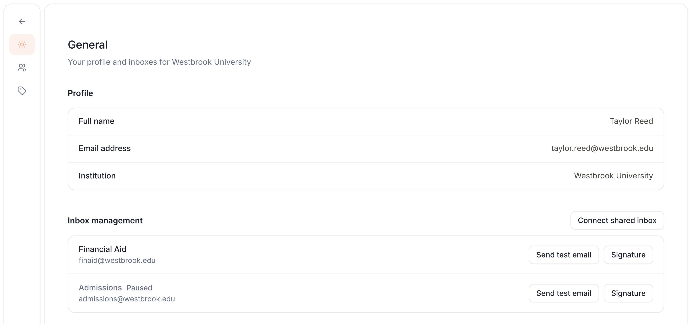
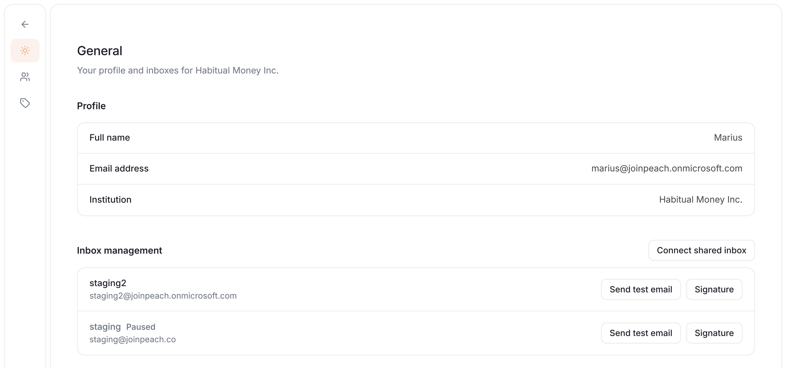
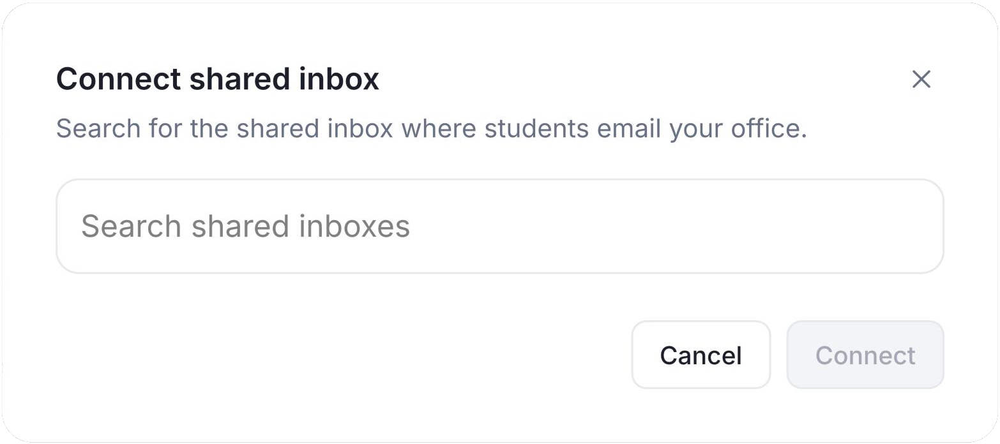
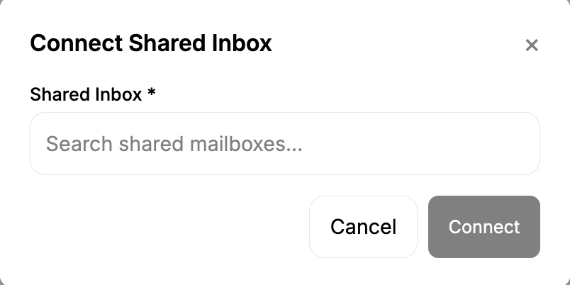

Peach uses shared inboxes to receive student inquiries and send responses on behalf of your office.

Shared inboxes can be connected during onboarding or at any time from Settings.

---

## Before you begin

Before connecting a shared inbox, ensure that:

- Your institution's IT team has completed the Microsoft 365 setup process
- You have access to the shared mailbox in Microsoft 365
- You are assigned as an Admin in Peach

---

## Connecting a shared inbox during onboarding

The shared inbox selection screen is only shown during onboarding when Peach does not yet have a shared inbox connected for your institution.

This commonly occurs when:

- A new institution is setting up Peach for the first time
- The first administrator is completing onboarding

You may not see this step if another user has already connected a shared inbox.

Examples include:

- An IT administrator testing the integration
- Another administrator completing setup before you
- An existing Peach deployment

<Note>
  Even if you do not see the shared inbox step during onboarding, you can connect additional inboxes later from Settings.
</Note>

---

## Connect a shared inbox from Settings

Navigate to:

```text
Settings → General
```

Under **Inbox management**, click the **Connect shared inbox** button.

<Frame>
  
  
</Frame>

---

## Select a shared inbox

Begin typing the name of the shared mailbox you want to connect.




Examples include:

- [financialaid@college.edu](mailto:financialaid@college.edu)
- [finaid@college.edu](mailto:finaid@college.edu)
- [scholarships@college.edu](mailto:scholarships@college.edu)

Select the mailbox from the search results.

Select **Connect**.

<Info>
  If the shared mailbox does not appear when searching, contact your Microsoft administrator to verify mailbox permissions.
</Info>

---

## What happens next?

After connecting a shared inbox:

<Steps>
  <Step title="Emails begin syncing">
    Incoming emails from the shared mailbox are imported into Peach.
  </Step>
  <Step title="Cases are created">
    Student inquiries become cases that can be managed by your team.
  </Step>
  <Step title="Responses can be sent">
    Staff can send emails directly from the connected shared mailbox.
  </Step>
</Steps>

---

## Next step

<Card title="Explore Cases" icon="ticket" href="https://docs.joinpeach.co/tickets">
  Learn how incoming emails become cases and how your team can manage student inquiries in Peach.
</Card>

<Info>
  Having trouble with your connection? See [Microsoft 365 troubleshooting](/troubleshooting) for help with sign-in, mailbox access, and email delivery issues.
</Info>
