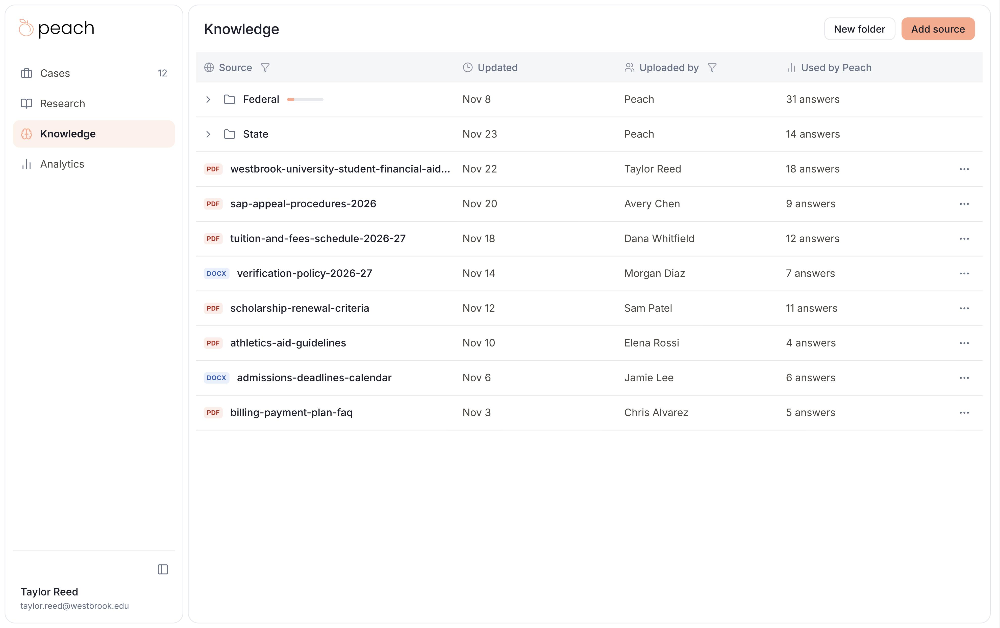
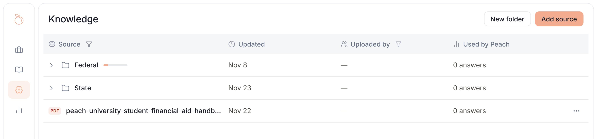

The knowledge base contains the information Peach's AI can reference when generating responses to student inquiries.

Peach includes federal financial aid regulations in the knowledge base. Your institution can add its own policies, procedures, and other resources so AI-generated responses reflect both federal requirements and your institution's specific guidance.

---

## How it works

When Peach generates an AI-assisted response, it can reference information available in the knowledge base alongside the context of the student inquiry.

The knowledge base can include:

- Federal financial aid regulations
- Institutional policies and procedures
- Financial aid office guidance
- Scholarship information
- Verification procedures
- Satisfactory Academic Progress policies
- Appeal procedures
- Other resources your team uses when responding to students

<Info>
  Federal financial aid regulations are already included in Peach. Your team does not need to upload these materials.
</Info>

---

## Add your institution's resources

Adding your institution's own resources helps Peach generate responses that reflect the policies and procedures specific to your school.

There are two ways to add information to the knowledge base by selecting **Add source**:

- Upload a file
- Paste a link

<Frame>
  
  
</Frame>

**Upload a file** to add a document to the knowledge base.

You can use this to add institutional documents such as policies, procedures, reference materials, and other resources your team relies on when responding to students.

Once added, the information in the document becomes available for Peach's AI to reference when generating responses.

<Tip>
  Consider adding the same resources your staff would normally consult before answering a student question. This gives Peach access to the institution-specific information your team uses every day.
</Tip>

Select **Paste a link** to add information from a webpage to the knowledge base.

This is useful when important institutional information is maintained on your website rather than in a document.

For example, you might add links to pages containing:

- Financial aid policies
- Scholarship information
- Important dates and deadlines
- Satisfactory Academic Progress requirements
- Appeals information
- Frequently asked questions

<Info>
  Adding institutional resources helps Peach account for your school's specific policies and procedures when assisting with student responses.
</Info>

---

## Manage sources

Select the **⋯** menu next to a source to:

- **Open in new tab**: View the original document or page.
- **Replace**: Upload a new version of the source when a policy changes.
- **Move to folder**: Reorganize the source.
- **Delete**: Remove the source so Peach stops using it.

---

## Keep information up to date

The quality of institution-specific answers depends on the information in Knowledge.

When your institution changes a policy or procedure, use **Replace** to update the source so Peach works from current guidance.

<Tip>
  Review Knowledge base periodically. Check **Used by Peach** and **Updated** to find sources that are outdated or unused, and remove sources that no longer apply..
</Tip>

---

## Federal regulations and guidance

Peach includes a built-in collection of federal financial aid regulations, guidance, and other authoritative sources in the **Federal** folder. Your institution does not need to upload these materials to its knowledge base.

<Note>
  Your institution's knowledge base complements these federal sources. Add your own policies, procedures, and guidance to give Peach the institution-specific context it needs when assisting your team.
</Note>

Peach's federal knowledge sources include:

### Federal law and regulations

- [Federal Student Aid Handbook](https://fsapartners.ed.gov/knowledge-center/fsa-handbook), organized by award year
- [Federal statutes and regulations, including the Higher Education Act and CFR Title 34](https://www.ecfr.gov/current/title-34)
- Official U.S. Department of Education and Federal Student Aid guidance
- Student-facing federal guidance, including FAFSA, NSLDS, and [StudentAid.gov](https://studentaid.gov/)

### Federal student aid guidance

Peach also includes published guidance and interpretations from the U.S. Department of Education and Federal Student Aid, including:

- [Dear Colleague Letters](https://fsapartners.ed.gov/knowledge-center/library/resource-type/Dear%20Colleague%20Letters)
- [Electronic Announcements](https://fsapartners.ed.gov/knowledge-center/library/resource-type/Electronic%20Announcements)
- [GEN, APP, CB, and similar guidance series](https://fsapartners.ed.gov/knowledge-center/library)
- Official Q&As and published interpretations from Federal Student Aid and the U.S. Department of Education

### Regulatory and legislative developments

Peach's federal knowledge sources also include materials related to developing or future requirements, including:

- [Proposed regulations](https://www.federalregister.gov/)
- [Enacted legislation with future effective dates](https://www.congress.gov/)
- [Pending legislative developments](https://www.congress.gov/)
- [Federal Register notices](https://www.federalregister.gov/)
- [Executive orders](https://www.whitehouse.gov/presidential-actions/executive-orders/)

<Info>
  Peach distinguishes between current requirements and developing or future regulatory changes when using federal information to assist with email responses.
</Info>

---

## State regulations and guidance

Peach includes a built-in collection of state financial aid regulations, guidance, and other authoritative sources in the **State** folder. Your institution does not need to upload these materials to its knowledge base.

---

## Organize your knowledge base

Resources in the knowledge base can be organized into folders to make them easier for your team to manage. Select **New folder** to group related sources.

For example, you might organize institutional resources by topic, such as:

- Scholarships
- Loans
- Verification
- Satisfactory Academic Progress
- Appeals
- Institutional Policies

Organization helps your team maintain the knowledge base as policies and procedures change over time.

---

## Knowledge base and AI-generated drafts

When Peach generates a draft, it can reference relevant information from your institution's knowledge base alongside federal financial aid sources and the context of the student's inquiry.

This helps Peach generate responses that account for institution-specific information such as policies, procedures, requirements, deadlines, and internal guidance.

<Info>
  Keeping your knowledge base current gives Peach access to the same institution-specific information your staff relies on when responding to students.
</Info>

[Learn more about AI-generated drafts →](/case-details#draft-with-ai)
