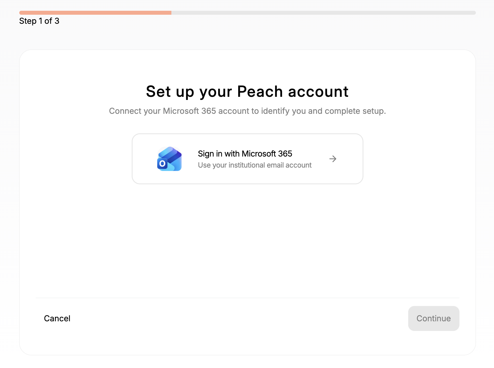
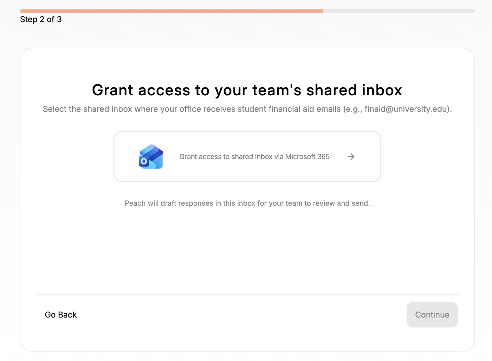
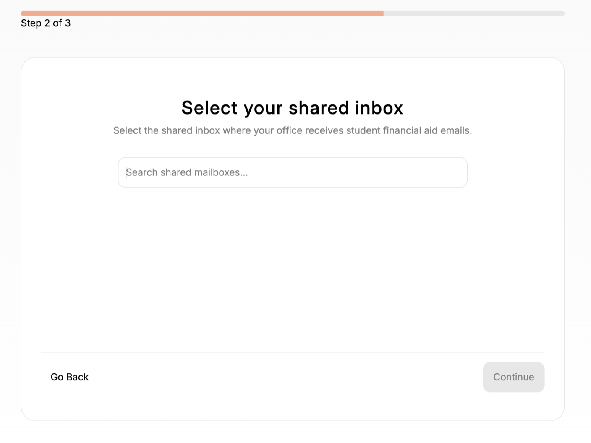
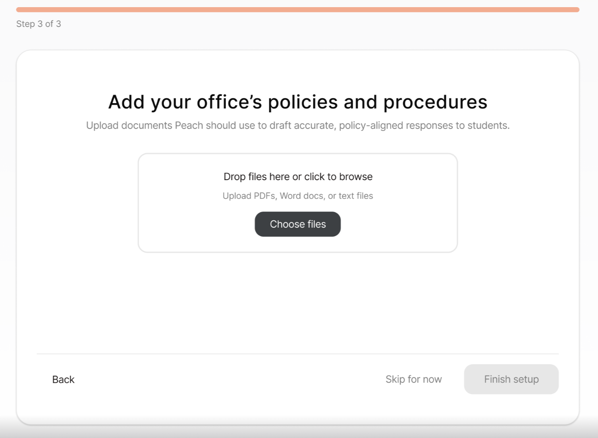

This guide walks through the initial setup process that new users complete when accessing Peach for the first time.

Most users complete setup in less than 5 minutes.

---

## Before you begin

Peach relies on your institution's email environment to authenticate users and connect shared mailboxes.

Before starting setup, confirm that your IT team has completed the Microsoft 365 integration process.

Your IT team should have:

- Configured Peach in Microsoft Entra
- Granted the required Microsoft permissions
- Assigned users or security groups to the Peach application
- Granted access to the shared mailbox your office uses for student communications

<Info>
  Most setup issues occur when the Microsoft integration has not been completed or the user does not have access to the appropriate shared mailbox.
</Info>

[View the Microsoft 365 setup guide](/overview)

<Note>
  Once your IT team has completed these steps, you can continue with onboarding.
</Note>

---

## What you'll accomplish

By the end of setup, you will:

- Sign in using your institutional account
- Connect your team's shared inbox
- Upload institutional policies and procedures
- Invite team members
- Prepare Peach to draft policy-aligned responses

---

## Step 1: Sign in

Authenticate using your institutional Microsoft 365 account.

Peach uses your organization's existing authentication system and does not require a separate password.



<Note>
  Once authentication is complete, Peach will identify the shared mailboxes you have access to.
</Note>

---

## Step 2: Connect your shared inbox

Depending on how your institution was set up, you may not see this step during onboarding.

<Frame>
  
</Frame>

The shared inbox selection screen is only shown when Peach does not yet have a shared inbox connected for your institution.

If another user has already configured Peach, such as:

- An IT administrator testing the Microsoft integration
- Another administrator completing setup
- A staff member who previously connected an inbox

then Peach may skip this step and continue directly to the next stage of onboarding.

<Info>
  Even if you do not see this step during onboarding, you can connect additional shared inboxes at any time from **Settings → Email Integration**.

  See the [Connect a shared inbox](/connect-a-shared-inbox) guide for detailed instructions.
</Info>

If displayed, select the shared mailbox your office uses to communicate with students.

Common examples include:

- [financialaid@college.edu](mailto:financialaid@college.edu)
- [finaid@college.edu](mailto:finaid@college.edu)
- [scholarships@college.edu](mailto:scholarships@college.edu)

Begin typing the mailbox name and select the appropriate inbox.



<Warning>
  If your shared mailbox does not appear, contact your Microsoft administrator to verify mailbox permissions.
</Warning>

---

## Step 3: Upload policies and procedures

Upload the documents Peach should use when generating drafts and answering questions.

Examples include:

- Financial aid policies
- Verification procedures
- Scholarship guidelines
- Appeal processes
- Internal office documentation



Supported file types:

- PDF (.pdf)
- Microsoft Word (.docx)
- Text files (.txt)

<Info>
  Peach uses these documents to generate institution-specific responses rather than generic financial aid guidance.
</Info>

<Note>
  You can skip this step and upload documents later to the knowledge base.
</Note>

---

## Step 4: Invite your team

Once your inbox is connected, invite other staff members who should have access to Peach.

Navigate to:

```text
Settings → Team Management
```

Administrators can add users individually or grant access through Microsoft security groups.

Each user can be assigned one of the following roles:

### Admin

Admins can:

- Manage users
- Configure integrations
- Connect shared inboxes
- Manage platform settings

### Editor

Editors can:

- Work on tickets
- Generate AI-assisted drafts
- Send emails
- Access connected inboxes

<Info>
  Only users who have been assigned access to the Peach application by your institution's IT team can sign in.
</Info>

<Note>
  We recommend inviting all staff members who regularly respond to student inquiries from your shared mailbox.
</Note>

---

## What happens next?

<Steps>
  <Step title="Your inbox begins syncing">
    Incoming student emails are imported into Peach.
  </Step>
  <Step title="Documents are indexed">
    Uploaded materials become available to the AI assistant and email drafting workflows.
  </Step>
  <Step title="Your team can collaborate">
    Staff members can access Peach and work on tickets together.
  </Step>
  <Step title="Student inquiries are resolved faster">
    Generate drafts, reference institutional policies, and send responses directly from Peach.
  </Step>
</Steps>

---

## Next steps

<CardGroup cols={2}>
  <Card title="Explore Tickets" icon="ticket" href="https://docs.joinpeach.co/tickets">
    Learn how to manage student inquiries, collaborate with your team, and respond with AI-assisted drafts.
  </Card>

  <Card title="Try the AI Assistant" icon="sparkles" href="https://docs.joinpeach.co/ai-assistant">
    Ask a financial aid question and get guidance grounded in federal regulations and your institution's resources.
  </Card>
</CardGroup>
