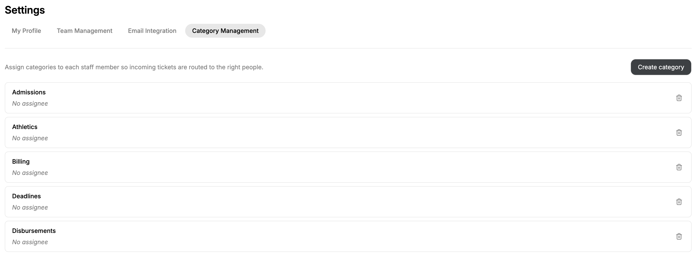
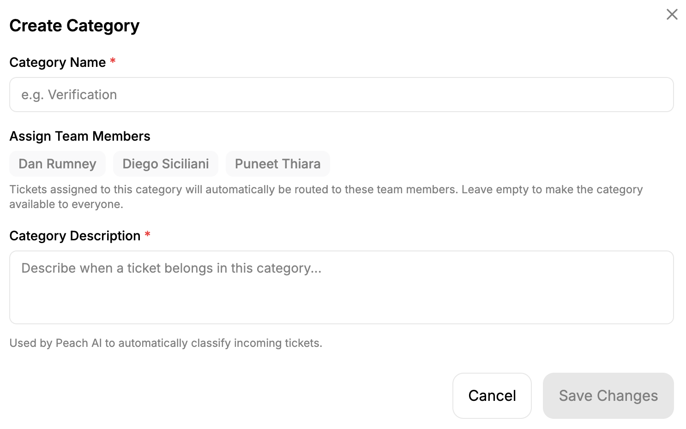

Categories help organize incoming tickets and route inquiries to the appropriate members of your team.

Peach AI automatically classifies incoming tickets using the categories your institution has configured.

To manage categories, go to **Settings → Category Management**.

## Manage categories

The Category Management page displays all categories currently available to your institution.

Each category can also have one or more team members assigned to it.

When a new ticket is classified into a category with assigned team members, Peach can automatically route the ticket to the appropriate staff member.

<Warning>
  Category-based assignment applies only to new incoming tickets. Adding a team member to a category does not retroactively reassign existing tickets.
</Warning>

## Assign team members

Assign team members to a category when you want incoming tickets in that category to be automatically routed to those staff members.

For example, you might assign staff members who specialize in loan questions to a **Loans** category.

### When multiple team members are assigned

More than one team member can be assigned to the same category.

When a new ticket is classified into that category, Peach assigns it to the team member in that category who currently has the **fewest open tickets assigned to them**.

<Tip>
  Assign multiple staff members to high-volume categories to help distribute incoming inquiries across your team.
</Tip>

If no team members are assigned to a category, the category can still be used to classify tickets without automatically routing them to a specific staff member.

## Create a category

Select **Create category** to add a new category.

You will configure three things:

### Category name

Enter a clear name for the category, such as:

- Verification
- Loans
- Scholarships
- Satisfactory Academic Progress
- Disbursements

### Assigned team members

Select the team members who should automatically receive new tickets classified into the category.

You can also leave this blank if you do not want tickets in the category to be automatically assigned.

### Category description

Describe the types of messages that should be assigned to the category.

<Warning>
  **Be thorough when writing category descriptions.**

  Peach AI uses the category description to determine whether an incoming message belongs in that category. The more clearly you define what should and should not be included, the more information Peach has when classifying incoming tickets.
</Warning>

For example, instead of:

> Questions about verification.

Use a more descriptive definition:

> Questions related to financial aid verification, including verification selection, required documentation, verification worksheets, conflicting information identified during verification, and the status or completion of the verification process.

<Tip>
  If two categories cover similar topics, use the descriptions to clearly explain the difference between them.
</Tip>

## Automatic classification and assignment

When a new email arrives in a connected shared inbox:

<Steps>
  <Step title="Peach evaluates the message">
    Peach analyzes the incoming inquiry.
  </Step>
  <Step title="Peach assigns a category">
    Peach uses your institution's category definitions to determine the appropriate category for the ticket.
  </Step>
  <Step title="Peach checks the category's team members">
    If staff members are assigned to the category, Peach identifies the eligible team member with the fewest open tickets.
  </Step>
  <Step title="The ticket is assigned">
    Peach assigns the new ticket to that team member.
  </Step>
</Steps>

Staff can still change the category or assignee from the Ticket details page after a ticket is created.

[Learn more about Ticket details →](/ticket-details)
