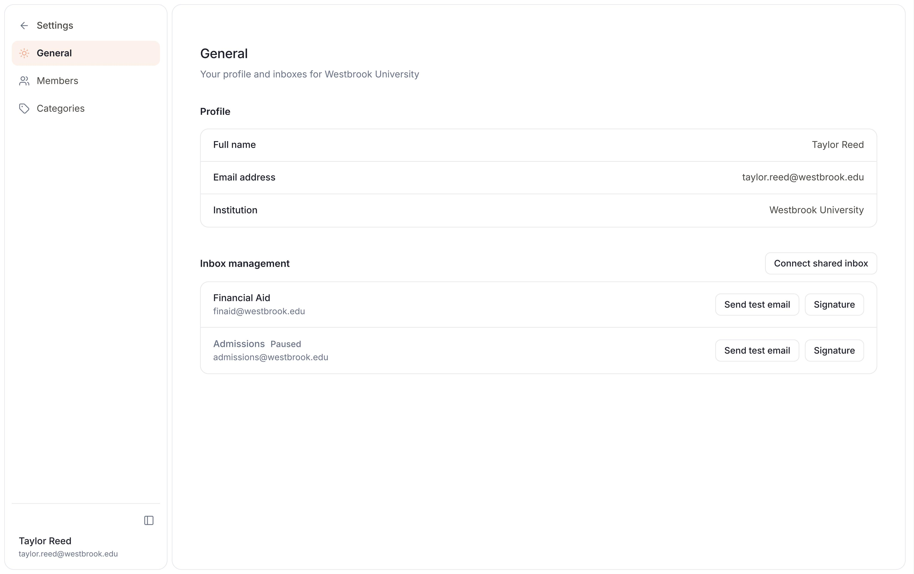

To open Settings, select your initials in the bottom-left corner, then select **Settings**. Settings has three sections: **General**, **Members**, and **Categories**. Select the back arrow to return to Peach.

The **General** section shows your profile and the shared inboxes connected to Peach.

<Frame>
  
  
</Frame>

## Profile

The **Profile** contains the basic information associated with your Peach account.

Your profile displays:

- **Full name**: Your name as it appears in Peach
- **Email address**: The email address associated with your Peach account
- **Institution**: Your institution's name

## Inbox management 

The **Inbox management** section lets Admins manage the shared mailboxes connected to Peach.

From here, you can:

- View connected shared inboxes
- Connect additional shared inboxes
- Update the email signature for each shared inbox
- Test outbound email delivery
- Enable or disable a connected shared inbox

Peach's connection to your institution's email environment is managed through Microsoft 365. For setup instructions, required permissions, troubleshooting, and other technical details, see the Microsoft 365 integration guides.

[View Microsoft 365 integration guides →](https://docs.joinpeach.co/overview)

For step-by-step instructions specifically for adding another mailbox:

[Learn how to connect a shared inbox →](https://docs.joinpeach.co/connect-a-shared-inbox)

## Report a bug

If you experience an issue while using Peach, select your initials in the bottom-left corner, then select **Report bug** to contact the Peach team.

When submitting a report, include as much information as possible about what you were doing and what happened.

<Info>
  The Peach team will respond to reported bugs within 24 hours.
</Info>

## Sign out

Select your initials in the bottom-left corner, then select **Sign out** to end your current Peach session.
