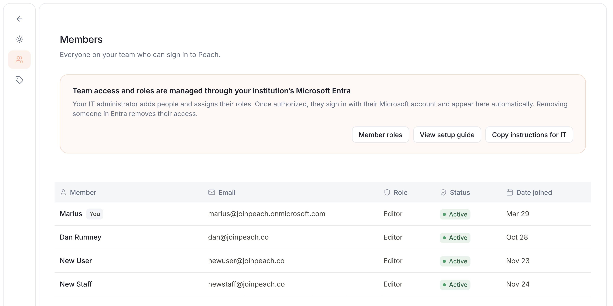

The **Members** section shows everyone on your team.

To access Members, go to **Settings → Members**.

<Frame>
  
  
</Frame>

## How team access works

Team access and roles are managed through your institution's **Microsoft Entra**, not inside Peach.

<Steps>
  <Step title="Your IT administrator adds people">
    IT assigns staff members, or security groups they belong to, to the Peach Enterprise Application in Microsoft Entra, and gives each one a role.
  </Step>
  <Step title="Staff sign in">
    Assigned staff members sign in to Peach with their Microsoft account. There is no separate invitation.
  </Step>
  <Step title="They appear in Members">
    After signing in, they appear in the Members list automatically.
  </Step>
</Steps>

<Warning>
  Removing someone in Microsoft Entra removes their access to Peach.
</Warning>

To add someone, change a role, or remove access, contact your IT administrator. On the Members page you can:

- Select **Member roles** to open the role descriptions in these docs.
- Select **View setup guide** to open the Admin setup guide.
- Select **Copy instructions for IT** to copy setup instructions you can send to your IT administrator.

<Info>
  Your institution's Microsoft administrator must also configure the appropriate access to the Peach Enterprise Application before a user can sign in.
</Info>

[Learn more about Admin and Editor roles →](https://docs.joinpeach.co/onboarding#step-4-invite-your-team)

## Members list

The **Members** section shows the staff members who have been added to your Peach account.

You can view each member's:

- Name
- Email address
- Role
- Status
- Date joined
