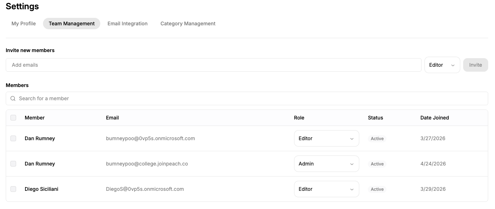

The **Team Management** tab allows administrators to invite staff members to Peach and manage existing members of their team.

To access Team Management, go to **Settings → Team Management**.

## Invite team members

To invite someone to Peach:

<Steps>
  <Step title="Enter their email address">
    Enter the staff member's institutional email address under **Invite new members**.
  </Step>
  <Step title="Select a role">
    Choose the appropriate role for the staff member.
  </Step>
  <Step title="Send the invitation">
    Select **Invite**.
  </Step>
</Steps>

Peach supports **Admin** and **Editor** roles.

<Info>
  Your institution's Microsoft administrator must also configure the appropriate access to the Peach Enterprise Application before a user can sign in.
</Info>

[Learn more about Admin and Editor roles →](https://docs.joinpeach.co/onboarding#step-4-invite-your-team)

## Manage team members

The **Members** section shows the staff members who have been added to your Peach account.

You can view each member's:

- Name
- Email address
- Role
- Status
- Date joined

Administrators can also update a team member's role from the **Role** dropdown.
