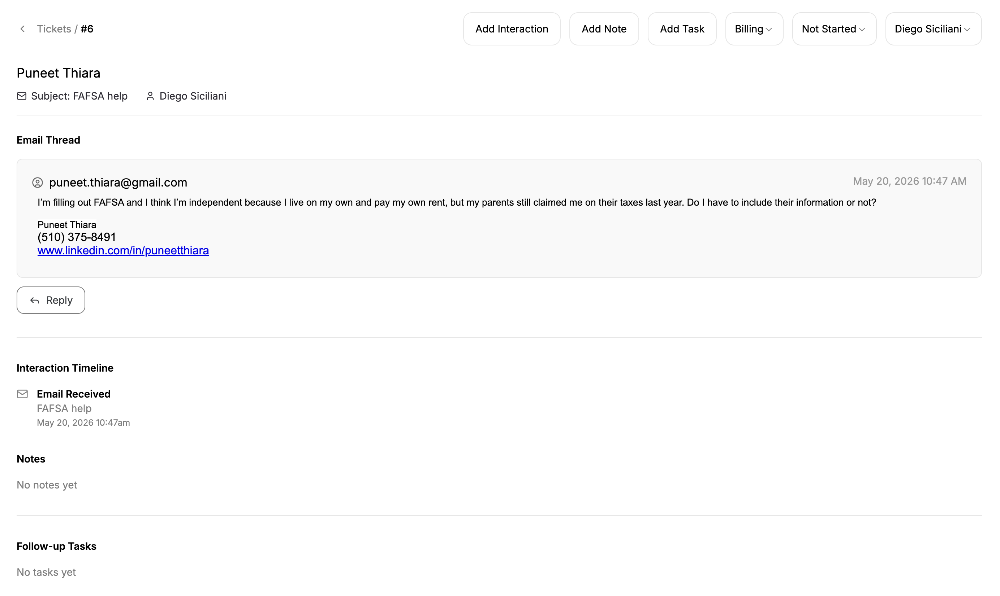
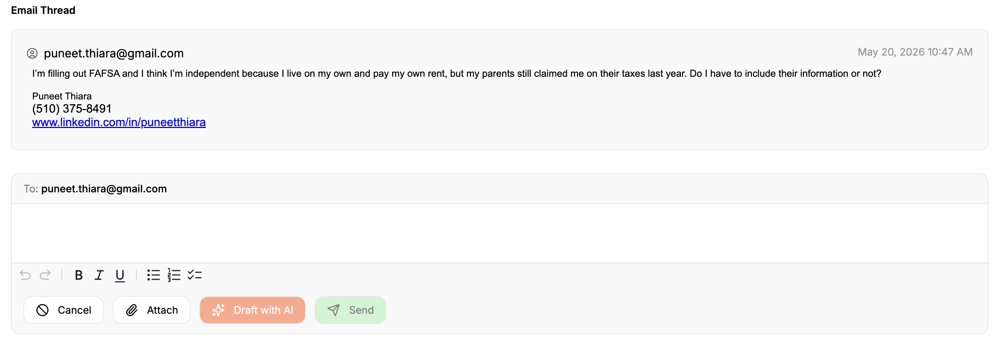
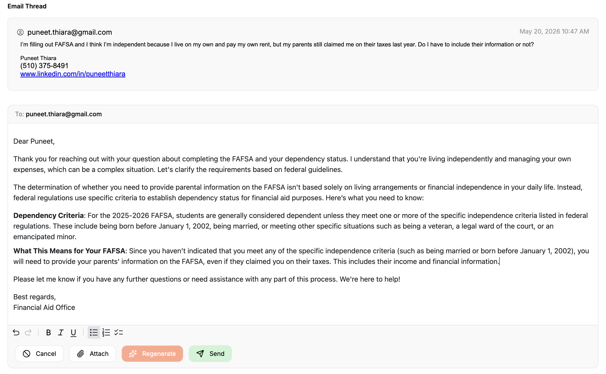
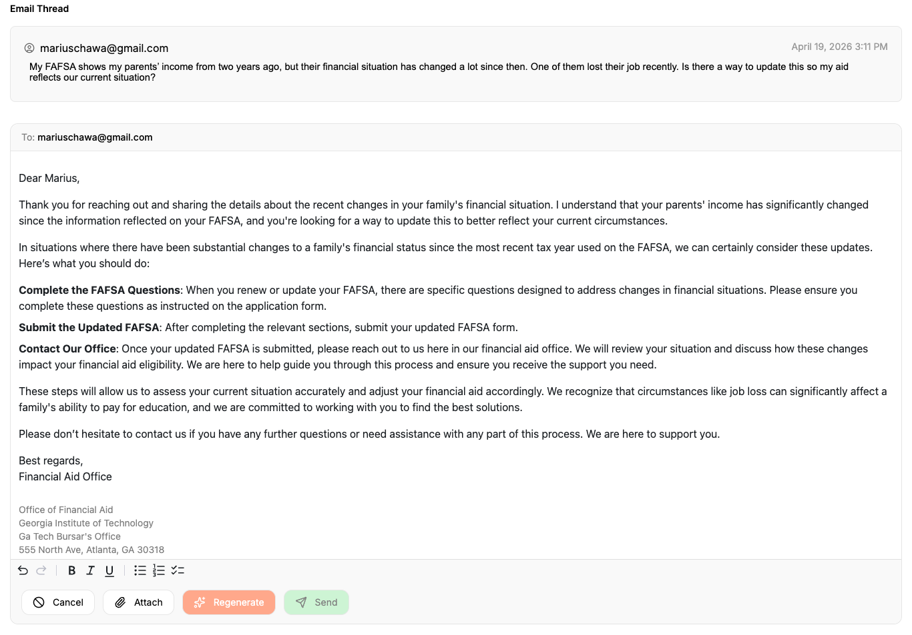

Open a ticket to view the full history of a student inquiry, respond to the student, collaborate with your team, and manage follow-up activity.

Each ticket brings together the conversation, interactions, internal notes, tasks, assignment, and status in one place.

---

## Ticket overview

At the top of each ticket, you can see the student, email subject, category, status, and assigned team member.

You can also use the controls in the upper-right corner to manage the ticket.

---

## Manage a ticket

From the top of the ticket, you can:

- Add an interaction
- Add an internal note
- Add a follow-up task
- Change the category
- Update the status
- Assign the ticket to a team member

### Add an interaction

Select **Add Interaction** to add another interaction with the student to the ticket.

Interactions can include:

- Another email
- A phone call
- A walk-in conversation

<Info>
  Adding interactions keeps relevant student communications together so staff can see the full context of an inquiry in one ticket.
</Info>

### Add a note

Select **Add Note** to add internal context for your team.

Notes are visible to Peach users at your institution and are not sent to the student.

Use notes for information such as:

- Internal context
- Research completed by another staff member
- Special circumstances
- Instructions for the next person working the ticket

### Add a task

Select **Add Task** to create a follow-up item associated with the ticket.

Tasks can be used to track work that needs to happen before the inquiry can be completed.

<Tip>
  Use tasks to keep follow-up work organized and make sure important next steps don't get lost, especially when an inquiry requires action from multiple team members or over multiple days.
</Tip>

### Change the category

Use the category dropdown to update the topic associated with the ticket.

Categories help your team organize inquiries and can also be used to filter tickets from the Tickets page.

<Note>
  Categories can be customized to match the types of inquiries your office receives.

  [Learn more about Category management →](/settings/category-management)
</Note>

### Update the status

Use the status dropdown to reflect the current state of the ticket.

Available statuses include:

- **Not Started**
- **In Progress**
- **On Hold**
- **Resolved**
- **No Ticket Required**

### Assign the ticket

Use the assignee dropdown to assign the ticket to a team member.

Assignment makes it clear who is responsible for following up on the inquiry.

<Tip>
  Tickets can also be automatically assigned to specific team members based on their category. This can help route incoming inquiries to the right person without requiring manual assignment.

  [Learn more about Category management →](/settings/category-management)
</Tip>

---

## Review the email thread

The email thread displays the conversation associated with the ticket.

Review previous messages to understand the full context of the student's inquiry before responding.

---

## Reply to a student

You can respond to an email directly from the ticket.

There are two ways to draft a response.

### Write your own response

Type directly into the response editor.

You can format your response and attach files before sending.

### Draft with AI

Select **Draft with AI** to have Peach generate a response based on the context available in the ticket.

Peach can use information including:

- The student's inquiry
- Earlier messages in the ticket
- Institutional policies and procedures available to Peach
- Other relevant ticket context

<Info>
  AI-generated drafts are designed for staff review. You can edit the response before sending it to the student.
</Info>

### Regenerate a draft

If you want Peach to create a different response, select **Regenerate**.

The existing draft will be replaced with a newly generated response based on the ticket context.

### Attach files

Select **Attach** to include documents or other files with your response.

When your response is ready, select **Send**.

---

## Interaction timeline

The **Interaction Timeline** provides a chronological summary of communications associated with the ticket.

It can include events such as:

- Emails received
- Emails sent
- Additional interactions added by staff

This gives staff a quick way to understand what has already happened without reviewing the entire email thread.

---

## Notes

The **Notes** section displays internal notes that have been added to the ticket.

Notes help staff share context that should remain internal to the financial aid office.

<Info>
  Notes are not included in emails sent to students.
</Info>

---

## Follow-up tasks

The **Follow-up Tasks** section displays tasks associated with the ticket.

Use tasks to keep track of additional work that needs to be completed as part of resolving the student's inquiry.

---

## Keep the full history together

A ticket can contain more than an email conversation.

By adding interactions, notes, and tasks, your team can maintain a complete record of work related to the student's inquiry.

For example:

<Steps>
  <Step title="Student sends an email">
    The original inquiry is automatically imported from the shared inbox.
  </Step>
  <Step title="Staff calls the student">
    The phone conversation is added using **Add Interaction**.
  </Step>
  <Step title="A follow-up is needed">
    A staff member creates a task to track the additional work.
  </Step>
  <Step title="Internal context is recorded">
    A note is added so other team members have the context they need.
  </Step>
  <Step title="The student receives a response">
    Staff draft and send the final email directly from the ticket.
  </Step>
</Steps>

This keeps the full history of the inquiry available to anyone on your team who needs to work on it.
