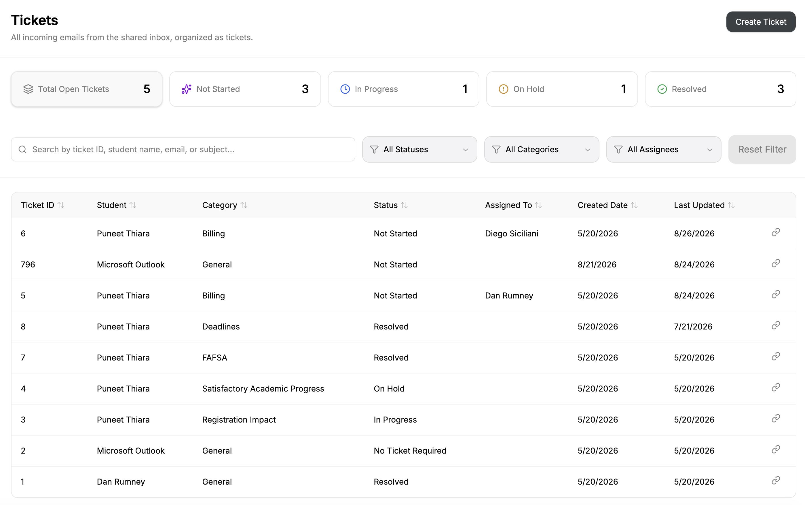
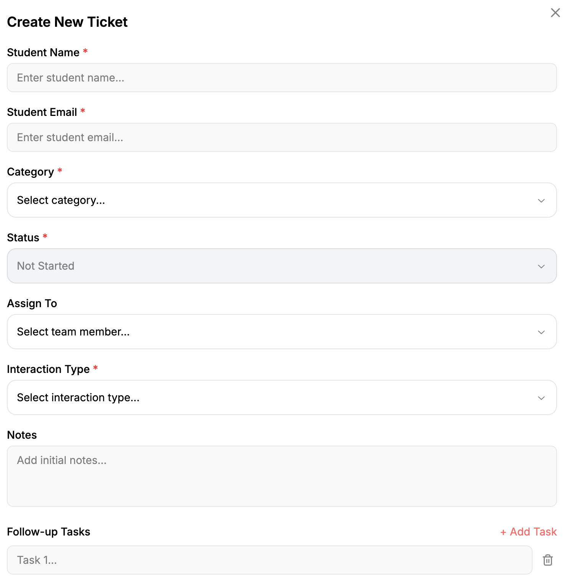

The Tickets page gives your team a central view of student inquiries and other communications.

Emails received by your connected shared inbox are automatically brought into Peach and organized as tickets, allowing your team to track and manage inquiries in one place.

---

## View tickets

The Tickets page displays all tickets across your connected shared inboxes.

At a glance, you can see:

- **Ticket ID**: The unique ID assigned to the ticket
- **Student**: The student or sender associated with the inquiry
- **Category**: The financial aid topic associated with the ticket
- **Status**: The ticket's current status
- **Assigned To**: The team member responsible for the ticket
- **Created Date**: When the ticket was created
- **Last Updated**: When activity most recently occurred on the ticket

<Info>
  Emails received through your connected shared inbox automatically appear in Peach as tickets. Your team does not need to manually create a ticket for each incoming email.
</Info>

---

## Ticket status

The cards at the top of the page provide a quick view of your current ticket workload.

Tickets can have one of five statuses:

- **Not Started**: Tickets that have not yet been worked
- **In Progress**: Tickets currently being worked
- **On Hold**: Tickets that have been temporarily paused
- **Resolved**: Tickets that have been completed
- **No Ticket Required**: Emails that do not require action or follow-up from your team

**Total Open Tickets** shows the total number of tickets that have not yet been resolved.

### Filter by status

Select any status card to quickly filter the ticket list to tickets with that status.

You can also use the **All Statuses** filter to view tickets with any status, including **No Ticket Required**.

For example, selecting **Not Started** displays only tickets that have not yet been worked.

---

## Search tickets

Use the search bar to find a specific ticket.

You can search by:

- Ticket ID
- Student name
- Email address

This can be helpful when a student contacts your office about an existing inquiry or when you need to locate a particular conversation.

---

## Filter tickets

Use the filters above the ticket list to narrow the tickets displayed.

You can filter by:

- **Status**
- **Category**
- **Assignee**

Filters can be used together to find a specific group of tickets.

For example, you could display only **Not Started** FAFSA tickets assigned to a particular staff member.

Select **Reset Filter** to return to the full ticket list.

---

## Sort tickets

Select the arrows next to a column heading to sort the ticket list.

Tickets can be sorted using fields such as:

- Ticket ID
- Student
- Category
- Status
- Assignee
- Created Date
- Last Updated

<Info>
  Sorting by **Last Updated** can be useful for finding conversations with recent activity.
</Info>

---

## Create a ticket

Most tickets are created automatically from emails received through your connected shared inbox. You can also create a ticket manually when an inquiry begins outside of email, such as during a phone call or walk-in conversation.

Select **Create Ticket** in the upper-right corner of the Tickets page.

Enter the information for the ticket:

- **Student Name**: Enter the student's name
- **Student Email**: Enter the student's email address
- **Category**: Select the category that best matches the inquiry
- **Status**: Select the current status of the ticket
- **Assign To**: Optionally assign the ticket to a team member
- **Interaction Type**: Select how the interaction occurred
- **Notes**: Add any relevant context about the inquiry
- **Follow-up Tasks**: Add any actions that need to be completed

When you're finished, select **Create Ticket**.

<Tip>
  Manually creating a ticket for phone calls, walk-ins, and other interactions keeps student communications and follow-up work in the same place as email inquiries.
</Tip>

## Open a ticket

Select a ticket from the list to open the **Ticket details** page.

From there, you can review the full history of the inquiry, respond to the student, add interactions, notes, and follow-up tasks, and manage the ticket's category, status, and assignment.

[Learn more about Ticket details →](/ticket-details)
