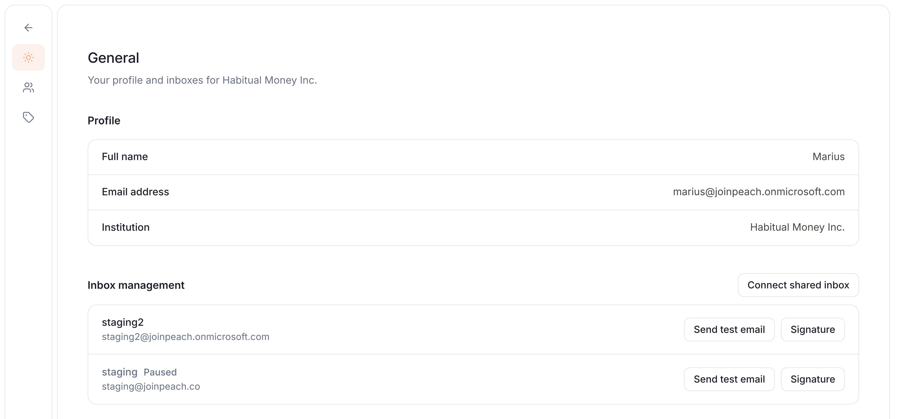
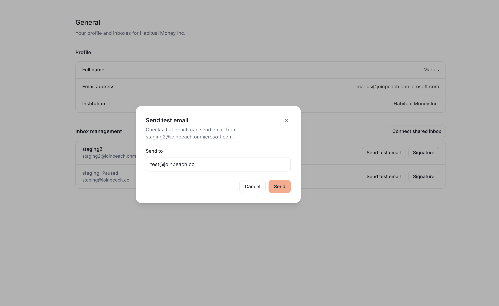

This guide covers the most common Microsoft 365 integration issues.

## Peach does not appear in Enterprise Applications

### Symptoms

- Peach is not visible in Microsoft Entra
- Users cannot be assigned

### Resolution

Verify that the Admin Consent URL was completed using a Microsoft Entra administrator account.

Refresh the Enterprise Applications page after consent is granted.

<Check>
  You should see Peach listed as an Enterprise Application.
</Check>

---

## Users cannot sign in

### Symptoms

- Login fails after Microsoft authentication
- User receives an access error

### Resolution

Verify the user has been assigned to the Peach Enterprise Application in Microsoft Entra.

The user, or a group they belong to, must be assigned either the **Editor** or **Admin** role.

Navigate to:

```text
Microsoft Entra → Enterprise Applications → Peach → Users and Groups
```

Confirm the user or security group is listed.

---

## Shared mailbox does not appear

### Symptoms

- User completes onboarding
- Expected mailbox is missing

### Resolution

Verify the user has access to the mailbox within Microsoft 365.

Peach can only display mailboxes that Microsoft has granted the user permission to access.

<Info>
  Mailbox permissions are managed within Microsoft Exchange and Microsoft 365.
</Info>

---

## Emails are not appearing in Peach

### Symptoms

- Mailbox connects successfully
- New emails do not appear

### Resolution

Verify:

- The mailbox connection completed successfully
- The mailbox still exists
- Microsoft permissions have not been revoked

You can disconnect and reconnect the mailbox from Peach Settings.

---

## Outbound emails fail to send

### Symptoms

- Email sends successfully in Peach
- Recipient never receives the message
- Microsoft generates a Non-Delivery Report (NDR)

### Resolution

Many Microsoft tenants apply stricter filtering to application-generated mail.

Your Microsoft administrator may need to create an Application Access Policy.

Example:

```powershell
New-ApplicationAccessPolicy `
-AppId 45c38646-07a4-4998-b43c-58e1b5c0bcee `
-PolicyScopeGroupId <your shared mailbox> `
-AccessRight RestrictAccess `
-Description "Scope Peach Mail.Send to shared mailboxes only"
```

<Warning>
  This configuration varies by institution and may require assistance from your Microsoft administrator or Microsoft support.
</Warning>

---

## Test outbound email delivery

Peach includes a built-in email delivery test.

Navigate to:

```text
Settings → General → Inbox management
```

Select **Send test email** for the connected mailbox.

Send a test message to your email address.

<Frame>
  
  
</Frame>

<Frame>
  
  
</Frame>

<Check>
  Receiving the test email confirms that Microsoft is allowing outbound mail from Peach.
</Check>

---

## Still need help?

If the issue persists, gather the following information before contacting support:

- Institution name
- Shared mailbox address
- User email address
- Screenshot of the error
- Any Microsoft NDR message

Providing this information will help us resolve the issue more quickly.
